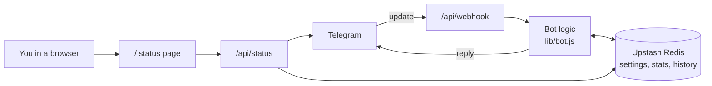

<div align="center">

# 🔍 Raw Inspector Bot

**Send any message to a Telegram bot and get back the exact raw JSON Telegram delivered.**
Serverless on Vercel, settings and stats stored in Upstash Redis, with a live status page on your own domain.


</div>

---

## ✨ Features

- **Raw JSON of anything**: text, media, forwards, polls, locations, edits, reactions, member changes.
- **Smart output**: short results arrive as a formatted code block, long ones as a `.json` file.
- **Inspector tools**: file IDs, entities, ID lookup, chat and member info, field extraction by path.
- **Per-user settings** saved in Redis, so they survive every deploy and cold start.
- **Status web page** on your Vercel domain: bot, webhook, Redis, update counts, commands.
- **Owner alerts**: channel posts, member updates and reactions are sent to the owner's DM.
- **Safe by default**: access list, secret-verified webhook, flood protection, setup key.
- **Free to run** on Vercel Hobby and the Upstash free tier.

---

## 🧭 How it works



Vercel runs functions only while a request is being handled, so the bot uses a **webhook**
(Telegram calls your server) instead of polling. Anything that must survive between requests lives in Redis.

---

## 📁 Project structure

```
.
├── api/
│   ├── webhook.js     Telegram sends every update here
│   ├── setup.js       one-time: registers the webhook and bot commands
│   └── status.js      read-only JSON used by the status page
├── lib/
│   ├── bot.js         all commands and handlers
│   ├── config.js      env vars, command list, allowed update types
│   └── store.js       Upstash Redis client
├── public/
│   └── index.html     status page served at /
├── package.json
├── vercel.json
└── .env.example
```

---

## 🚀 Deploy in 6 steps

### 1. Create the bot
Open **@BotFather** in Telegram, send `/newbot`, and copy the token.

### 2. Create the database
Sign up at **upstash.com**, create a Redis database, and open its **REST API** section.
Copy the REST URL and the REST token. No port is needed, and the `redis://` endpoint is not used.

### 3. Put the code on GitHub
Upload this folder to a new repository.

### 4. Import into Vercel
**Vercel → Add New → Project →** pick the repository **→ Deploy**.

### 5. Add environment variables
**Settings → Environment Variables**, one row per variable (name in *Key*, value in *Value*):

| Key | Value | Required |
|---|---|:---:|
| `BOT_TOKEN` | Token from @BotFather | ✅ |
| `SETUP_KEY` | A long random text you invent (16+ characters, letters and numbers only) | ✅ |
| `UPSTASH_REDIS_REST_URL` | `https://xxxx.upstash.io` | ✅ |
| `UPSTASH_REDIS_REST_TOKEN` | Token from the Upstash REST API section | ✅ |
| `ALLOWED_IDS` | Comma-separated Telegram user IDs, first one is the owner. Empty means everyone. | ➖ |
| `WEBHOOK_SECRET` | Custom webhook secret. Derived from `BOT_TOKEN` when not set. | ➖ |

> Connected Upstash through the Vercel Marketplace? It adds `KV_REST_API_URL` and `KV_REST_API_TOKEN`,
> and the code reads those automatically.

Then **Deployments → ⋯ → Redeploy** so the variables take effect.

### 6. Connect the webhook
Open this once in a browser (use your **production** domain):

```
https://YOUR-APP.vercel.app/api/setup?key=YOUR_SETUP_KEY
```

Expected answer:

```json
{ "ok": true, "webhook": "https://YOUR-APP.vercel.app/api/webhook", "commands": 14 }
```

Now open `https://YOUR-APP.vercel.app` and message your bot. Run step 6 again only if you change the domain.

---

## 💬 Commands

### Inspect

| Command | What it does |
|---|---|
| *(any message)* | Replies with its raw JSON |
| `/raw` | Reply to a message to get its raw JSON |
| `/file` | Same, always as a `.json` file |
| `/summary` | Readable overview: type, sender, chat, dates, keys |
| `/entities` | Lists links, mentions, hashtags and other entities |
| `/fileinfo` | `file_id`, unique ID, size, MIME type and `file_path` of replied media |
| `/path <a.b.c>` | Extracts one field, for example `/path from.id` or `/path photo.-1.file_id` |
| `/id` | User, chat, message, thread and forward IDs |
| `/chat [id\|@user]` | Full `getChat` info plus member count |
| `/member [id]` | Chat member info (groups and channels) |

### Settings

| Command | Options |
|---|---|
| `/settings` | Tap-to-cycle settings panel |
| `/mode auto\|text\|file` | `auto` sends long output as a file, `text` forces messages, `file` forces files |
| `/scope message\|update` | Show only the message, or the full update object |

The panel also toggles **Format** (pretty or compact JSON) and **Group auto-dump** (on or off).

### Other

| Command | What it does |
|---|---|
| `/ping` | Latency check |
| `/history [n]` | Last *n* updates as a file (owner only, max 50) |
| `/stats` | Update counts and user totals (owner only) |
| `/help` | Help menu |

Every text reply has **📎 JSON file** and **🗑 Delete** buttons.

---

## ⚙️ Behavior notes

- **Groups:** nothing is dumped automatically. Reply to a message with `/raw`, or turn on *Group auto-dump* in `/settings`.
- **Owner DM:** channel posts, member changes, join requests and reactions are forwarded to the first ID in `ALLOWED_IDS`.
- **Flood protection:** more than 20 updates in 10 seconds from one user are ignored.
- **Reactions and member updates** need the bot to be an admin where Telegram requires it.

---

## 🖥️ Status page

The root of your domain shows a live summary, with a JSON view at the top:

- Bot name and username, overall state (online, webhook missing, Redis down)
- Webhook endpoint, pending updates, last delivery error
- Redis connection and latency, users with saved settings, history size
- Updates received per type
- Command list

It is public but read-only and never shows tokens, user IDs or message content.

---

## 🩺 Troubleshooting

| Symptom | Fix |
|---|---|
| Page says **Webhook not connected** | Open the `/api/setup?key=...` link once |
| `{"error":"wrong key"}` | The `key=` in the link must match `SETUP_KEY` in Vercel exactly |
| `SETUP_KEY is not set` | Add the variable, then **Redeploy** |
| Bot does not reply | Check `ALLOWED_IDS` contains your ID (get it from @userinfobot). Check **Last error** on the status page and Vercel → Logs |
| Webhook error `401` or `403` in Last error | Run `/api/setup` again on the production domain. Preview URLs may be behind Vercel login |
| Redis shows an error | Check both Upstash variables, no quotes around the values, then Redeploy |
| `Save failed` in `/settings` | Redis is unreachable or the token is read-only. Use the normal write token |

---

## 🔐 Security

- Telegram calls `/api/webhook` with a secret header. Requests without it get `401`.
- `/api/setup` needs `SETUP_KEY`. Keep it private, and never commit `.env`.
- Set `ALLOWED_IDS` so only you can use the bot.
- If the token ever leaks, revoke it with **@BotFather → /revoke**, update `BOT_TOKEN` and redeploy.
- `/history` keeps the last 50 updates, **including message content**, in your Redis database.

---

## 📊 Limits

- **Upstash free tier:** 256 MB storage, 500K commands per month. Each update uses about 5 to 6 commands, so roughly 80K updates per month.
- Free Upstash databases can be archived after a long idle period. A bot in daily use keeps it active.
- **Vercel Hobby** is for personal, non-commercial projects.
- Telegram text messages are capped, so long JSON is split and large output becomes a file automatically.

---

## 🛠️ Local development

```bash
npm install
npm i -g vercel
cp .env.example .env     # fill in the values
vercel dev
```

Telegram needs a public HTTPS URL, so expose the local server with a tunnel and run `/api/setup`
against that URL, or just deploy to Vercel and read the logs there.

---

## 🧩 Stack

[Telegraf](https://telegraf.js.org) · [Upstash Redis](https://upstash.com) · [Vercel Functions](https://vercel.com/docs/functions)
